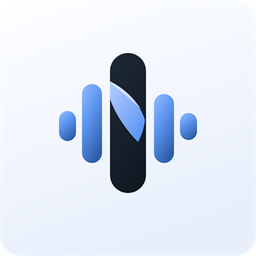
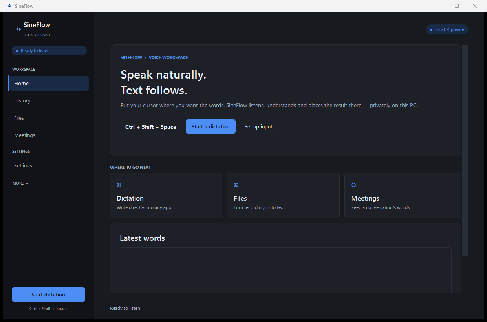
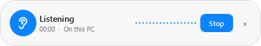
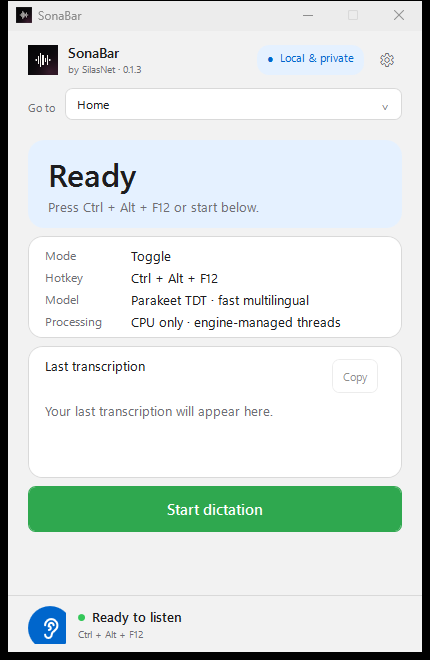
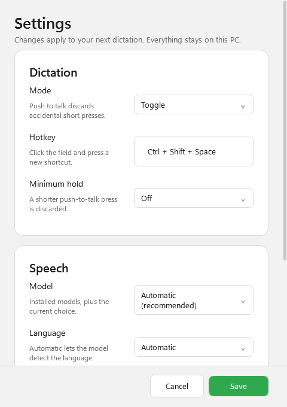
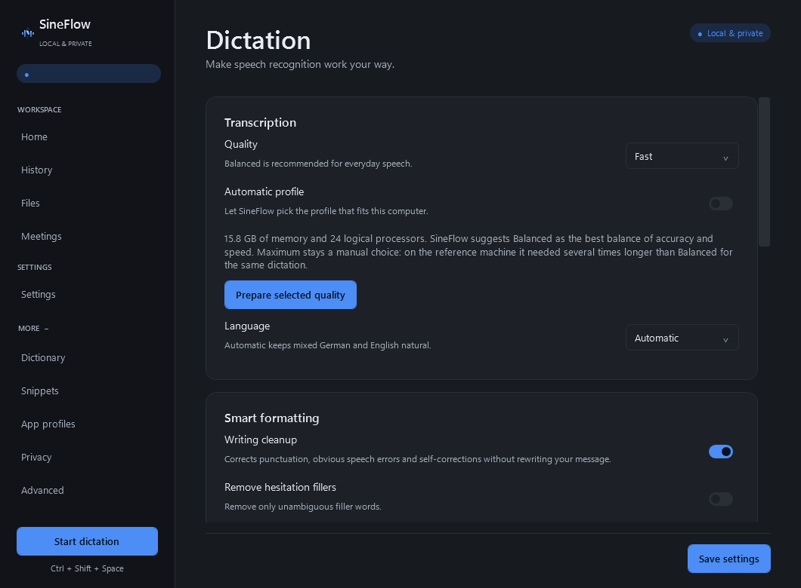
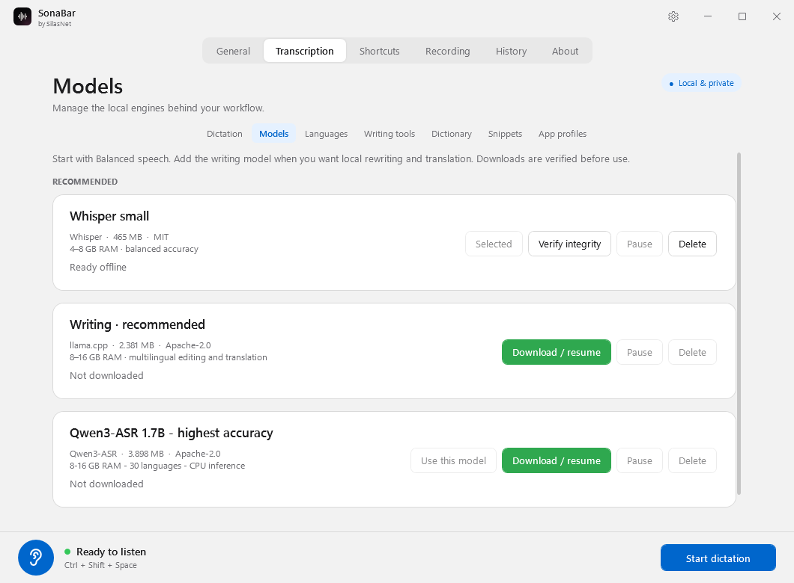
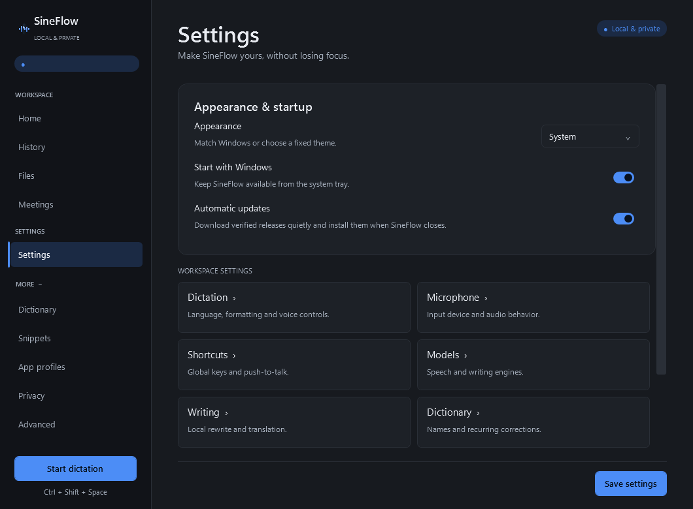
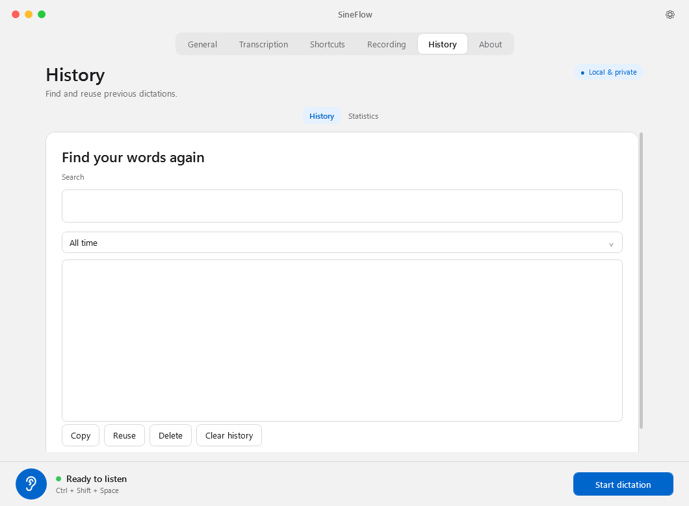

<div align="center">
  <a href="https://sonabar.silasnet.win"></a>

  <h1>SonaBar</h1>

  <p><strong>Sprache zu Text. Privat. Offline.</strong></p>

  <p>Diktiere direkt in deine Windows-Apps – lokal auf deinem PC, ohne Cloud.</p>

  <p>
    <a href="https://github.com/silasnetwin/SonaBar/releases/latest"></a>
    
    
    
    
    
  </p>

  <p>
    <a href="https://github.com/silasnetwin/SonaBar/releases/latest/download/SonaBar-Setup-x64.exe"></a>
    <a href="https://github.com/silasnetwin/SonaBar/releases/latest/download/SonaBar-Portable-x64.zip"></a>
  </p>

  <sub>Windows 11 x64 · Early Access · kostenlos · kein Konto erforderlich</sub>
</div>

<p align="center">
  <a href="#funktionen">Funktionen</a> ·
  <a href="#so-funktioniert-es">So funktioniert’s</a> ·
  <a href="#datenschutz">Datenschutz</a> ·
  <a href="#deine-sprache">Sprachen</a> ·
  <a href="#download">Download</a> ·
  <a href="#faq">FAQ</a>
</p>

<a href="docs/media/overview.png"></a>

<p align="center"><sub>SonaBar verwandelt Sprache in Text – dort, wo du gerade schreibst.</sub></p>

---

SonaBar ist eine lokale Diktier-App für Windows. Du drückst einen Shortcut, sprichst einen Satz und der Text erscheint im aktiven Feld – in deinem Browser, in Office, im Editor, im Chat oder im Terminal. Die Spracherkennung läuft auf deinem Computer. Kein Konto, keine Cloud, keine Telemetrie.

<p align="center">
  <a href="#diktat"><strong>Diktat</strong></a> ·
  <a href="#text-verfeinern"><strong>Text verfeinern</strong></a> ·
  <a href="#mehr-als-diktat"><strong>Mehr als Diktat</strong></a>
</p>

## So funktioniert es

**Ein Shortcut. Drei Schritte.**

| 1. Starten | 2. Sprechen | 3. Text erscheint |
| --- | --- | --- |
| Drücke <kbd>Ctrl</kbd> + <kbd>Shift</kbd> + <kbd>Space</kbd> in der App, in die du schreiben willst. | Sprich in deinem normalen Tempo. Die Aufnahme-Pille zeigt Dauer und Pegel. | Drücke den Shortcut erneut. SonaBar setzt den Text an die Cursorposition. |

<p align="center">
  
</p>

SonaBar merkt sich das zuletzt aktive externe Fenster. Wenn du die Diktat-Schaltfläche im SonaBar-Fenster benutzt, kehrt SonaBar vor der Aufnahme dorthin zurück – statt in sein eigenes Fenster zu schreiben.

## Funktionen

### Diktat

**Sprechen. Loslassen. Fertig.**

- Globaler Shortcut für jede Windows-App, optional als Push-to-Talk.
- Nicht aktivierendes Aufnahme-Overlay mit Dauer, Wellenform und Stop-Schaltfläche.
- Geprüfte Einfügewege: UI Automation, nativer Text, Unicode und Clipboard-Fallback.
- Passwortfelder werden erkannt und abgelehnt – dort wird nie Text eingefügt.
- Clipboard-Fallback stellt den vorherigen Inhalt wieder her.
- Rückgängig und erneut versuchen, wo Windows den eingefügten Text prüfen kann.
- Pro-App-Profile für Ton, Einfüge-Strategie, abschließendes Enter und Clipboard-Verhalten.
- Die Fußzeile zeigt die gemessene Zeit vom Ende der Sprache bis zum bestätigten Einfügen.
- Optionale dezente Feedback-Töne für Start, Ende und Fehler: **Off**, **Minimal** oder **Standard**. Die Töne werden von SonaBar erzeugt und ändern keine Windows-Soundeinstellungen.

### Text verfeinern

**Deine Worte. Aufgeräumt.**

- Optionales lokales Schreibmodell für Zeichensetzung, vorsichtige Korrekturen und Umformulierungen.
- Gesprochene Befehle am Ende eines Diktats: Aufzählung, professionelle E-Mail, freundlicherer Ton, nur Rechtschreibung, Füllwörter entfernen, Zusammenfassung, Klein- oder Großschreibung.
- Übersetzen in Englisch, Deutsch, Französisch, Spanisch, Italienisch, Portugiesisch, Niederländisch, Polnisch, Chinesisch und weitere Sprachen.
- Zahlen, Namen und Uhrzeiten werden beim Übersetzen geschützt. Verdächtige Ergebnisse werden verworfen, der Originaltext bleibt erhalten.
- Persönliches Wörterbuch mit expliziten *gehört → gemeint*-Ersetzungen.
- Snippets mit Variablen und exakten Auslösern. Optional ersetzen sie den Auslöser auch beim Tippen – nach Leertaste, Enter, Tab oder Satzzeichen; standardmäßig deaktiviert.

### Mehr als Diktat

**Nicht nur ein Satz.**

- Audiodateien und Videos in Stapeln transkribieren und als TXT, SRT oder VTT exportieren.
- Meetings über Mikrofon, Systemaudio oder beides aufnehmen, mit laufendem Transkript.
- Optionale lokale Sprechertrennung, Umbenennung und Export als PDF oder Markdown.
- History mit Suche, Aufbewahrungsregeln und optionalem Speichern.
- Statistik über Diktate, Wörter, Aufnahmezeit und durchschnittliches Tempo.

### Überall einsetzbar

**Dein Text gehört dorthin, wo du schreibst.**

SonaBar ist für Browser, Office, Editoren, Chat-Clients und Terminals gebaut. Standard-Textfelder werden zuerst über Windows UI Automation geprüft, danach über Clipboard oder Unicode eingefügt.

Bei reichen Chat- und Code-Editoren (Discord/Slack, VS Code/OpenCode, Browser-Composer) setzt SonaBar auf einen einzigen Clipboard-Paste statt auf lange Tastatur-Batches. Lange Unicode-Fallbacks werden in kleinen Paketen gesendet; normalisiert die Ziel-App den Text, meldet SonaBar ehrlich `Paste sent — check the app/target` statt eines falschen Erfolgs.

Für Spiele und Oberflächen, die Windows keine Textprüfung erlauben – zum Beispiel **Roblox** – gibt es den **Compatibility**-Modus. SonaBar sendet den Paste an das verifizierte Vordergrundfenster und meldet exakt:

> `Paste sent — check the app/target`

Windows kann in solchen Fenstern nicht zurücklesen, ob der Text angekommen ist. Deshalb ist das eine ehrliche Bestätigung des Paste-Vorgangs und keine erfundene Erfolgsmeldung.

### Für Windows gebaut

**Nativ statt Web-View.**

- .NET 10 WPF mit nativem Windows-Rahmen, Minimieren und Schließen; das Fenster ist bewusst nicht maximierbar.
- Feste kompakte Fenstergröße, native Fensterpositionierung und Per-Monitor-DPI.
- Helle Oberfläche als Standard, Dark und „Windows folgen“ per Klick.
- Ein einziges kompaktes Hauptfenster mit Status, letzter Transkription und einem Start-/Stopp-Knopf. Alle bisherigen Seiten erreichst du über **Go to**; das Zahnrad in der Kopfzeile öffnet die kompakten Einstellungen, das Tray-Menü **Tools** bietet Schnellzugriffe.
- Tray-Icon, optionaler Start mit Windows und eine kompakte Aufnahme-Pille.
- Hilfe direkt in der App unter **About → Help** – ohne externe Dokumentation.
- Portable ZIP oder per-user Installation – beides ohne Administratorrechte.

### Deine Sprache

**Mehrsprachig, je nach Modell.**

| Engine | Sprachen | Hinweis |
| --- | --- | --- |
| **whisper.cpp** | breite Sprachabdeckung | lokal, CPU oder GPU je nach Build |
| **Parakeet TDT 0.6B v3** | 25 europäische Sprachen | NeMo-Speech.cpp, CPU-verifiziert |
| **Qwen3-ASR 1.7B** | 30 Sprachen + automatische Erkennung | lokaler Python-Sidecar über benannte Pipe |

Die Sprachliste im Einstellungsfenster folgt dem gewählten Modell. Eine ältere, nicht unterstützte Sprache fällt automatisch auf die Spracherkennung zurück, statt ein Diktat scheitern zu lassen.

## Datenschutz

<div align="center">
  <h3>Deine Stimme bleibt bei dir.</h3>
  <p>Audio verlässt deinen Computer nicht. Die Transkription und das optionale Schreibmodell laufen lokal.</p>
</div>

- **Keine Cloud-Transkription.** Kein Konto, keine Telemetrie, keine Werbe-IDs.
- **Kein Listening-Socket.** SonaBar öffnet keinen lokalen oder entfernten Port.
- **Qwen bleibt isoliert.** Der Qwen-Sidecar läuft über eine zufällige, authentifizierte Windows Named Pipe und wird beim Beenden geschlossen.
- **Modelle sind geprüft.** Jeder Download ist an einen SHA-256-Digest gebunden und wird vor dem Laden verifiziert.
- **History ist optional.** Aufbewahrung und Löschen liegen bei dir.
- **Passwortfelder bleiben leer.** SonaBar erkennt sie und verweigert das Einfügen.

## Screenshots

| Kompaktes Hauptfenster | Kompakte Einstellungen |
| --- | --- |
|  |  |

| Diktat-Einstellungen | Modelle |
| --- | --- |
|  |  |

| Einstellungen | Heller Modus |
| --- | --- |
|  |  |

## Download

<p align="center">
  <a href="https://github.com/silasnetwin/SonaBar/releases/latest/download/SonaBar-Setup-x64.exe"></a>
  <a href="https://github.com/silasnetwin/SonaBar/releases/latest/download/SonaBar-Portable-x64.zip"></a>
</p>

| Paket | Inhalt | Größe |
| --- | --- | --- |
| **Installer** | [`SonaBar-Setup-x64.exe`](https://github.com/silasnetwin/SonaBar/releases/latest/download/SonaBar-Setup-x64.exe) | ca. 493 MB |
| **Portable** | [`SonaBar-Portable-x64.zip`](https://github.com/silasnetwin/SonaBar/releases/latest/download/SonaBar-Portable-x64.zip) | ca. 360 MB |
| **Prüfsummen** | [`SHA256SUMS.txt`](https://github.com/silasnetwin/SonaBar/releases/latest/download/SHA256SUMS.txt) | wenige KB |

Beide Pakete sind self-contained: .NET, die nativen Inferenz-Bibliotheken und die Qwen-Python-Laufzeit sind enthalten. Sprachmodelle werden erst in der App heruntergeladen, nicht mit dem Installer ausgeliefert.

> **Early Access.** 0.1.3 ist ein unsignierter Entwicklungsbuild. Signierte Releases und die automatische Update-Verifizierung sind vorbereitet, aber noch nicht veröffentlicht.
>
> **Hinweis zum Repository.** Das Repository ist derzeit privat. Die Release-Downloads sind für GitHub-Konten mit Zugriff erreichbar. Für eine öffentliche Produktseite müssen Repository oder Download-Host freigegeben werden.

### Systemvoraussetzungen

| | |
| --- | --- |
| Betriebssystem | Windows 11 x64. Windows 10 22H2 ist Best Effort und nicht Teil der Testmatrix. |
| Arbeitsspeicher | 4 GB für Base, 8 GB für Balanced oder Qwen3-ASR-1.7B, 16 GB für das größte Whisper-Modell |
| Speicherplatz | ca. 1,1 GB für die App inklusive Qwen-Laufzeit, plus 140 MB bis 4,1 GB pro Sprachmodell |
| Mikrofon | jedes WASAPI-Eingabegerät |
| Internet | nur für den ersten Modell-Download und optionale Updates |

### Installation und erster Start

1. **Installer starten** oder das Portable ZIP entpacken und `SonaBar.App.exe` öffnen. Administratorrechte sind nicht nötig.
2. **Mikrofon wählen.** SonaBar listet die Eingänge und bietet eine kurze Testaufnahme an.
3. **Profil wählen.** Fast, Balanced oder Maximum. Balanced ist die Alltagsempfehlung; die Hardware-Seite erklärt, was dein Rechner leistet.
4. **Modell herunterladen.** Die Modellseite zeigt Größe, Lizenz und Beschleunigung. Downloads sind fortsetzbar und werden per SHA-256 geprüft.
5. **Shortcut drücken.** <kbd>Ctrl</kbd> + <kbd>Shift</kbd> + <kbd>Space</kbd> in einem Textfeld, sprechen, nochmal drücken.

Nach dem ersten Start bietet SonaBar ein kurzes Onboarding an. Danach lebt die App im Tray.

## Was ist neu in 0.1.3

- **Fenster zuerst.** Die Oberfläche erscheint nach etwa 0,6 Sekunden; Engine- und Modellarbeit startet danach.
- **Kein stiller Download.** Ein fehlendes Modell ist ein sichtbarer Zustand mit direktem Link zur Modellseite.
- **Compatibility-Modus für Spiele.** Roblox und andere nicht inspizierbare Fenster erhalten den Paste, ohne falschen „Could not insert“-Fehler.
- **Windows-Rahmen und helle Oberfläche.** Eigene Titelleiste, segmentierte Tabs und eine gemeinsame Farbwelt für Light, Dark und hohen Kontrast.
- **Fokus-Rückgabe.** SonaBar merkt sich das zuletzt aktive externe Fenster, damit Diktate aus dem App-Fenster im richtigen Ziel landen.

Vollständige Änderungen: [CHANGELOG.md](CHANGELOG.md) · [Release v0.1.3](https://github.com/silasnetwin/SonaBar/releases/tag/v0.1.3)

## Feinschliff im aktuellen Quellcode

- **Ein einziges kompaktes Hauptfenster.** SonaBar startet in einem 430 × 660 großen Dictate-Fenster mit Status, Modus, Shortcut, Modell, effektiver Verarbeitung, letzter Transkription und einem Start-/Stopp-Knopf. Das frühere große Workspace-Fenster gibt es nicht mehr. Alle 20 Seiten – General, Dictation, Writing, Models, Languages, Audio, Shortcuts, Custom Words, Snippets, Applications, History, Statistics, Privacy, Advanced, Debug, Files, Meetings, About und Help – erreichst du über **Go to**. Der Abschluss des Onboardings führt zurück in dieses Fenster.
- **Kompakte Einstellungen.** Das Zahnrad in der Kopfzeile öffnet einen Dialog für Modus, Shortcut, Mindest-Haltezeit, installiertes Modell oder Automatik, Sprache, Verarbeitungsgerät und Whisper-CPU-Threads. Schreibmodelle, eigene Wörter, Snippets, Anwendungen, History und Diagnose bleiben über **Go to** und das Tray-Menü **Tools** erreichbar.
- **Ehrliche CPU- und Thread-Wahl.** **Automatic**, **CPU** und **GPU / accelerated** ersetzen das alte Backend-Feld. Whisper nutzt die gewählte Thread-Zahl, fällt bei fehlender GPU auf CPU zurück und zeigt den effektiven Pfad; Parakeet und Qwen bleiben CPU-only und verwalten ihre Threads selbst. Das Gerät wird erst nach dem Speichern neu geladen.
- **Mindest-Haltezeit und Parakeet-Speech-Context.** Push-to-Talk kann sehr kurze versehentliche Presses verwerfen. Eigene Wörter werden bei Parakeet als nativer Speech-Context übergeben (maximal 64 Begriffe), aber die aktuelle TDT-Runtime ignoriert Word-Boosting ohne Flashlight-Decoder; SonaBar behauptet dafür keinen Genauigkeitsgewinn. Whisper und lokales Writing nutzen die Wörter weiterhin. Die Einstellungen migrieren mit Schema 5 ohne Datenverlust.
- **Hilfe in der App.** **About → Help** erklärt Diktat, Einfügeprobleme, Datenschutz, Diagnose und die kostenlose Produktpolitik.
- **Snippets auch beim Tippen.** Der Auslöser wird optional direkt in der Ziel-App ersetzt – nach Leertaste, Enter, Tab oder Satzzeichen. Auch mehrwörtige Auslöser wie `be right back` und Auslöser mit Satzzeichen wie `e.g.` funktionieren; ein Mausklick setzt den Tipp-Puffer zurück. Die Funktion ist standardmäßig deaktiviert, überspringt das SonaBar-Fenster und Passwortfelder und weist auf Grenzen bei Spielen und Apps mit Administratorrechten hin.
- **Klarere leere Seiten.** History, Statistik, Snippets und Anwendungen zeigen kurze Hinweise statt großer leerer Listen. Bei ausgeschalteter History führt ein direkter Weg zu den Datenschutzeinstellungen.
- **Feedback-Töne mit Vorschau.** Die Audio-Seite kann den Abschlusston vorhören; bei **Off** bleibt die Vorschau deaktiviert.

> Diese Verbesserungen sind im aktuellen Quellcode enthalten. Die bereits veröffentlichten v0.1.3-Pakete können älter sein, bis ein neues Paket gebaut und veröffentlicht wurde.

## Status

| Bereich | Stand |
| --- | --- |
| Kompaktes Hauptfenster | Einziges Produktfenster; alle Seiten über **Go to**; Einstellungen über das Zahnrad; Tray **Tools** für Schnellzugriffe |
| Diktat, Einfügen, History, Snippets, Dateien | Early Access, im Alltag nutzbar |
| Snippets beim Tippen | Optional, standardmäßig deaktiviert; Passwortfelder und das SonaBar-Fenster werden übersprungen |
| Meetings, Sprechertrennung, PDF-Export | Early Access; Qualität hängt von der Aufnahme ab |
| Parakeet TDT 0.6B v3 | Runtime enthalten; Modell auf Abruf; auf CPU verifiziert |
| Qwen3-ASR 1.7B | Runtime enthalten; Modell auf Abruf; auf CPU verifiziert |
| Roblox und undurchsichtige Fenster | Compatibility-Paste ohne Rücklesen; das Spiel muss das Ergebnis zeigen |
| Signierung und Update-Feed | vorbereitet, nicht veröffentlicht |

Bekannte Grenzen stehen in [docs/IMPLEMENTATION_STATUS.md](docs/IMPLEMENTATION_STATUS.md). Geräte- und App-Checks stehen in [docs/MANUAL_TEST_CHECKLIST.md](docs/MANUAL_TEST_CHECKLIST.md).

## FAQ

**Verlässt mein Audio den Computer?**
Nein. Aufnahme, Transkription und das optionale Schreibmodell laufen lokal. Es gibt kein Konto, keine Telemetrie und keinen Listening-Socket.

**Brauche ich Internet?**
Nur für den ersten Modell-Download und optionale Updates. Danach funktioniert das Diktat offline.

**Welches Modell soll ich nehmen?**
Balanced ist die Alltagsempfehlung und passt auf 8-GB-Rechner. Base ist die Wahl für 4 GB und langsamere Hardware; large-v3 ist für maximale Genauigkeit auf 16-GB-Rechnern gedacht.

**Funktioniert SonaBar in Claude, Roblox und anderen Apps?**
SonaBar ist für Browser, Office, Editoren, Chat-Clients und Terminals gebaut. Standard-Textfelder werden geprüft und anschließend befüllt. Bei Spielen wie Roblox, die Windows keine Textprüfung erlauben, sendet der Compatibility-Modus den Paste und meldet `Paste sent — check the app/target`; das Spiel muss den Text selbst anzeigen.

**Werden Passwortfelder befüllt?**
Nein. Passwortfelder werden erkannt und abgelehnt. Das gilt auch für die optionale Snippet-Ersetzung beim Tippen.

**Wo finde ich Hilfe?**
In der App unter **About → Help**. Dort stehen Schnellstart, Einfügeprobleme, Datenschutz, Diagnose und die kostenlose Produktpolitik. Die Hilfe ist lokal und benötigt keine externe Website.

**Kann ich SonaBar ohne Installation nutzen?**
Ja. Das Portable ZIP enthält denselben Build. Entpacken, `SonaBar.App.exe` starten; Einstellungen und History liegen weiterhin unter `%LOCALAPPDATA%\SilasNet\SonaBar`.

**Gibt es eine Mac- oder Linux-Version?**
Nein. Oberfläche, Hotkeys und Einfüge-Schicht sind Windows-spezifisch.

**Was kostet SonaBar?**
SonaBar ist kostenlos. Es gibt kein Abo, keine Testphase, keinen Checkout und keinen Lizenzserver. Die App bleibt ohne Konto nutzbar; optionale Modell-Downloads unterliegen den Lizenzen der jeweiligen Modelle. Die Signierung und der automatische Update-Feed werden unabhängig davon für einen stabilen Release fertiggestellt.

**Steht SonaBar in Verbindung zu WhisperBar?**
Nein. SonaBar ist ein unabhängiges Produkt von SilasNet. Es gibt keine Verbindung zu WhisperBar und keine gemeinsame Entwicklung.

## Für Entwickler

<details>
<summary><strong>Aus dem Quellcode bauen</strong></summary>

Voraussetzungen: .NET 10 SDK, Visual Studio 2022 mit C++-Desktop-Workload und CMake für die nativen Inferenz-Bibliotheken.

```powershell
git clone https://github.com/silasnetwin/SonaBar.git
cd SonaBar
git submodule update --init --recursive

# Bauen, testen, veröffentlichen und packen (Portable ZIP + Installer)
./build.ps1 -Configuration Release

# Oder Schritt für Schritt
.tools/dotnet/dotnet build SonaBar.slnx -c Release
.tools/dotnet/dotnet test  SonaBar.slnx -c Release
```

Der Release-Build schreibt `dist/SonaBar-Portable-x64.zip`, `dist/SonaBar-Setup-x64.exe` und `dist/SHA256SUMS.txt`. Er lädt außerdem die gepinnte CPython-Laufzeit und die Qwen-Python-Abhängigkeiten nach `dist/SonaBar/qwen`; die Qwen-Modellgewichte bleiben ein separater, geprüfter Download.

### Nativer Inferenz-Check

```powershell
.tools/dotnet/dotnet run --project tests/SonaBar.NativeSmoke -c Release -- .tools/jfk.wav artifacts/native-smoke.json
```

Parakeet und Qwen nutzen denselben Harness:

```powershell
.tools/dotnet/dotnet run --project tests/SonaBar.NativeSmoke -c Release -- .tools/jfk.wav artifacts/parakeet-smoke.json --model=parakeet-tdt-0.6b-v3 --speech-only

$env:SONABAR_QWEN_PYTHON="$PWD/dist/SonaBar/qwen/python.exe"
$env:SONABAR_QWEN_SIDECAR="$PWD/dist/SonaBar/qwen/qwen_sidecar.py"
.tools/dotnet/dotnet run --project tests/SonaBar.NativeSmoke -c Release -- .tools/jfk.wav artifacts/qwen-smoke.json --model=qwen3-asr-1.7b --speech-only
```

Der Qwen-Sidecar wird mit einer zufälligen Named Pipe pro Prozess und gegenseitiger HMAC-Authentifizierung gestartet. Er hat keinen Listening-Socket, lädt das Modell mit `local_files_only=True` und wird beim Beenden der App beendet.

### Repository-Aufbau

```text
src/            Anwendung und Module
tests/          xUnit-Suite und nativer Smoke-Test
installer/      per-user Installer
resources/      Icons, Markenvektoren, Lizenzen
scripts/        Asset- und Dependency-Tooling
docs/           Design, Verifikation und manuelle Testmatrix
```

</details>

## Dokumentation

| Dokument | Inhalt |
| --- | --- |
| [CHANGELOG.md](CHANGELOG.md) | Versionshistorie und sichtbare Änderungen |
| [docs/IMPLEMENTATION_STATUS.md](docs/IMPLEMENTATION_STATUS.md) | Umgesetzte Funktionen und bekannte Lücken |
| [docs/WHISPERBAR_PARITY.md](docs/WHISPERBAR_PARITY.md) | Funktionsabgleich und bewusste Unterschiede |
| [docs/MANUAL_TEST_CHECKLIST.md](docs/MANUAL_TEST_CHECKLIST.md) | Geräte-, Installer- und App-Checks |
| [SECURITY.md](SECURITY.md) | Privater Meldeweg für Sicherheitslücken |
| [THIRD_PARTY_NOTICES.md](THIRD_PARTY_NOTICES.md) | Lizenzen der enthaltenen Komponenten |

## Sicherheit

Bitte öffne für ein Sicherheitsproblem kein öffentliches Issue. Der private Meldeweg steht in [SECURITY.md](SECURITY.md).

## Lizenz

SonaBar ist proprietäre Software von SilasNet. Alle Rechte vorbehalten. Siehe [LICENSE](LICENSE).

Enthaltene Drittanbieter-Komponenten behalten ihre eigenen Lizenzen: whisper.cpp, NeMo-Speech.cpp, llama.cpp, .NET, NAudio, SQLite, PDFsharp, sherpa-onnx, WeSpeaker, CPython, PyTorch und Transformers. Die vollständige Attribution steht in [THIRD_PARTY_NOTICES.md](THIRD_PARTY_NOTICES.md) und unter `resources/licenses/`.

---

<div align="center">
  <p><strong>SonaBar</strong> · ein Produkt von <a href="https://sonabar.silasnet.win">SilasNet</a></p>
  <p><sub>Für Windows gebaut · Early Access 0.1.3 · kein Konto · keine Cloud · keine Telemetrie</sub></p>
</div>
